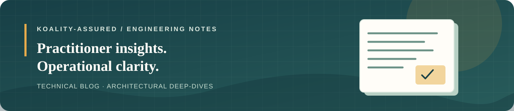

<div align="center">
  
  <h1>Koality-Assured Technical Blog</h1>
  <p>Engineering notes, architectural deep-dives, and practitioner guides from Koality-Assured.</p>
  <p>
    <sub><strong>ENGINEERING NOTES</strong> &nbsp;·&nbsp; <strong>ARCHITECTURAL PATTERNS</strong> &nbsp;·&nbsp; <strong>PRACTITIONER GUIDES</strong></sub>
  </p>
  <p>
    <a href="LICENSE"></a>
    <a href="#"></a>
    <a href="https://conventionalcommits.org"></a>
  </p>
  
</div>

## Catalog

### AI Engineering

#### The Context Tax: Why Subagents Need Clean-Slate State Instead of Full Chat Logs

Inheriting coordinator conversation history inflates token consumption by $O(M \cdot K \cdot T)$ and induces attention drift. This note explains why zero-flight dispatch and declarative contracts keep multi-agent harnesses reliable, accompanied by empirical benchmark data.

- **Date:** October 12, 2026
- **Reading Time:** 4 min read
- [Read the post](posts/AI-Engineering/clean-slate-specialist-context/POST.md)
- [Web version](https://ketron.dev/blog/clean-slate-context)
- [Companion white paper](https://github.com/Koality-Assured/koality-whitepapers/blob/main/papers/AI-Engineering/clean-slate-specialist-context/PAPER.md)

#### Token Counts Fell by 86.53%. Now Test the Task.

One synthetic run measured token reduction across 15 tool outputs using Headroom AI. This note examines what the benchmark confirmed, what was left open, and how to test whether compressed context still supports downstream agent tasks.

- **Date:** October 9, 2026
- **Reading Time:** 3 min read
- [Read the post](posts/AI-Engineering/context-efficiency-methods/POST.md)
- [Web version](https://ketron.dev/blog/context-efficiency-methods)
- [Companion white paper](https://github.com/Koality-Assured/koality-whitepapers/blob/main/papers/AI-Engineering/context-efficiency-methods/PAPER.md)

#### The Reveal Route Returns an Envelope: Keeping Secrets Out of Tool Results

Autonomous agents needing credentials can accidentally leak plaintext into conversation history. This note details envelope encryption patterns with opaque surrogate handles (`{{vault:sec_...}}`) and client-side decryption where tools return encrypted envelopes rather than raw secrets.

- **Date:** October 20, 2026
- **Reading Time:** 5 min read
- [Read the post](posts/AI-Engineering/reveal-route-returns-envelope/POST.md)
- [Web version](https://ketron.dev/blog/reveal-route-returns-envelope)
- [Companion white paper](https://github.com/Koality-Assured/koality-whitepapers/blob/main/papers/AI-Engineering/zero-plaintext-vault-reveal/PAPER.md)

#### A 0.95 Gate is Not a Scoreboard: Why Context Scrubbers Must Prioritize Precision Over Noisy Recall

Broad, noisy regex patterns generate false-positive cascades that hallucinate secrets in benign code and inflate tool outputs. This note explains why context scrubbers must enforce a precision-first threshold (>=0.95 precision) and format-marker validation before mutating agent context.

- **Date:** October 27, 2026
- **Reading Time:** 5 min read
- [Read the post](posts/AI-Engineering/precision-first-context-scrubbing/POST.md)
- [Web version](https://ketron.dev/blog/precision-first-context-scrubbing)
- [Companion white paper](https://github.com/Koality-Assured/koality-whitepapers/blob/main/papers/AI-Engineering/precision-first-context-scrubbing/PAPER.md)

#### Stop Grepping Your Monorepo: Why Layered BM25 and AST Slicing Beat Recursive LLM Dumps

Ungrounded grep dumps unranked noise across large codebases, incurring compounding context taxes and cache thrashing. This note demonstrates why multi-layered retrieval—combining BM25 lexical filtering, dense semantic vectors, and AST structural slicing—drastically cuts token consumption while preserving fact precision.

- **Date:** November 4, 2026
- **Reading Time:** 6 min read
- [Read the post](posts/AI-Engineering/stop-grepping-your-monorepo/POST.md)
- [Web version](https://ketron.dev/blog/stop-grepping-your-monorepo)
- [Companion white paper](https://github.com/Koality-Assured/koality-whitepapers/blob/main/papers/AI-Engineering/empirical-retrieval-cost-layers/PAPER.md)

#### Commit-Bound Proof Gates: Why Agent Verification Needs Exact Git HEAD Checks

Examines how post-proof Git mutations (`--amend`, `rebase`, `cherry-pick`, and trailing commits) evade status-only and ancestry-only verification checks, and presents 31-scenario offline gate measurements, deterministic negative routing, and clean-slate seeded-defect trial results.

- **Date:** November 10, 2026
- **Reading Time:** 6 min read
- [Read the post](posts/AI-Engineering/commit-bound-proof-gates/POST.md)
- [Web version](https://ketron.dev/blog/commit-bound-proof-gates)
- [Companion white paper](https://github.com/Koality-Assured/koality-whitepapers/blob/main/papers/AI-Engineering/commit-bound-proof-gates/PAPER.md)

---

## Article Format

Each catalog entry points to a standalone post at `POST.md`. Posts are organized by domain:

```text
posts/
  <domain>/
    <post-slug>/
      POST.md
```
