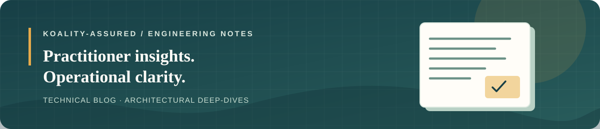

<div align="center">
  
  <h1>Koality-Assured Technical Blog</h1>
  <p>Engineering notes, architectural deep-dives, and practitioner guides from Koality-Assured.</p>
  <p>
    <sub><strong>ENGINEERING NOTES</strong> &nbsp;·&nbsp; <strong>ARCHITECTURAL PATTERNS</strong> &nbsp;·&nbsp; <strong>PRACTITIONER GUIDES</strong></sub>
  </p>
  <p>
    <a href="LICENSE"></a>
    <a href="#"></a>
    <a href="https://conventionalcommits.org"></a>
  </p>
  
</div>

## Catalog

### AI Engineering

#### The Context Tax: Why Subagents Need Clean-Slate State Instead of Full Chat Logs

Inheriting coordinator conversation history inflates token consumption by $O(M \cdot K \cdot T)$ and induces attention drift. This note explains why zero-flight dispatch and declarative contracts keep multi-agent harnesses reliable, accompanied by empirical benchmark data.

- **Date:** October 12, 2026
- **Reading Time:** 4 min read
- [Read the post](posts/AI-Engineering/clean-slate-specialist-context/POST.md)
- [Web version](https://ketron.dev/blog/clean-slate-context)
- [Companion white paper](https://github.com/Koality-Assured/koality-whitepapers/blob/main/papers/AI-Engineering/clean-slate-specialist-context/PAPER.md)

#### Token Counts Fell by 86.53%. Now Test the Task.

One synthetic run measured token reduction across 15 tool outputs using Headroom AI. This note examines what the benchmark confirmed, what was left open, and how to test whether compressed context still supports downstream agent tasks.

- **Date:** October 9, 2026
- **Reading Time:** 3 min read
- [Read the post](posts/AI-Engineering/context-efficiency-methods/POST.md)
- [Web version](https://ketron.dev/blog/context-efficiency-methods)
- [Companion white paper](https://github.com/Koality-Assured/koality-whitepapers/blob/main/papers/AI-Engineering/context-efficiency-methods/PAPER.md)

---

## Article Format

Each catalog entry points to a standalone post at `POST.md`. Posts are organized by domain:

```text
posts/
  <domain>/
    <post-slug>/
      POST.md
```
